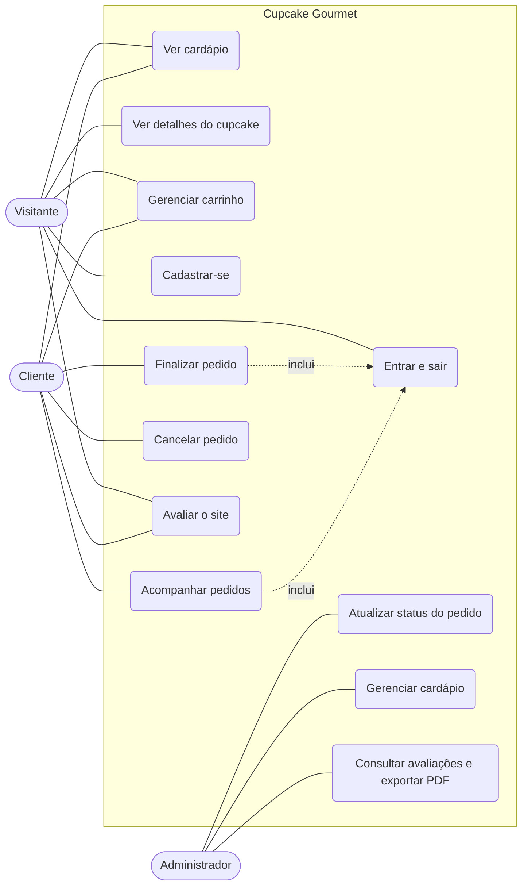
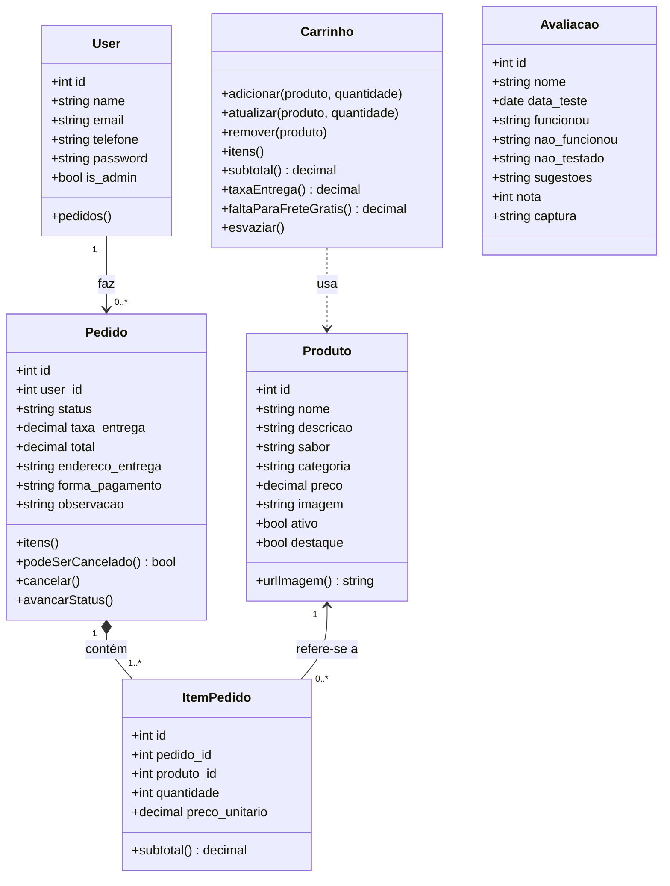
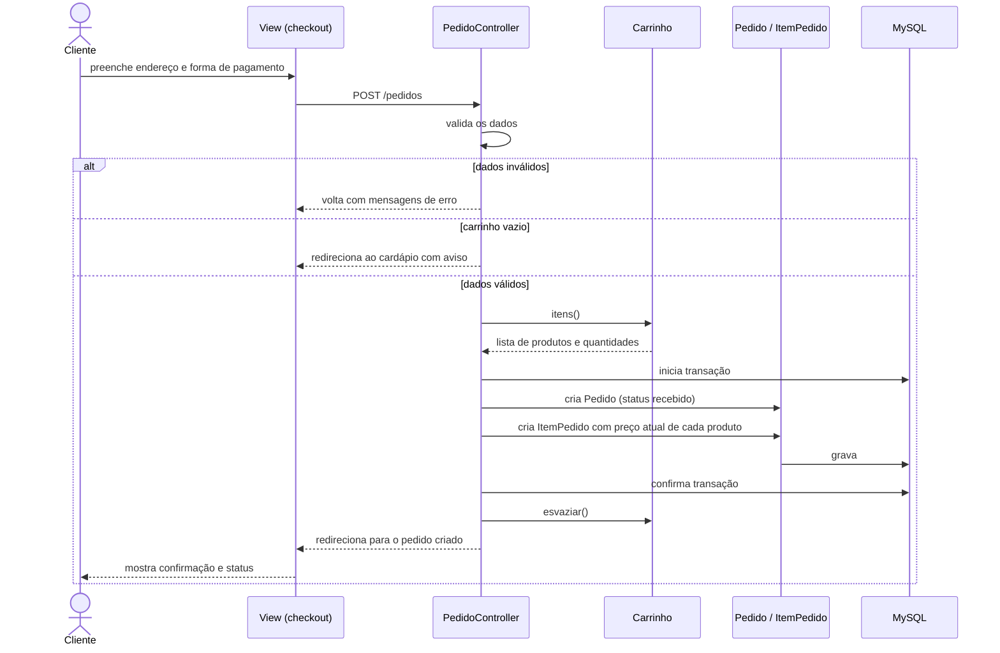
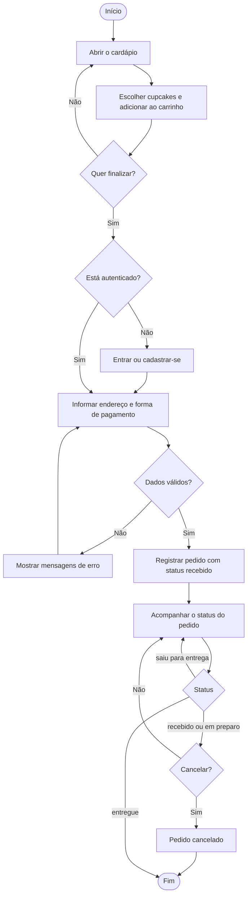
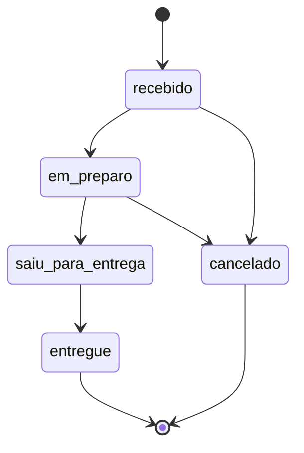

# 2. Modelagem UML

Os diagramas usam a sintaxe Mermaid, que o GitHub exibe direto no navegador.

## 2.1 Diagrama de casos de uso

## 2.2 Diagrama de classes

A classe `Carrinho` não é persistida: ela vive na sessão do usuário e só vira `Pedido` e
`ItemPedido` na finalização da compra.

## 2.3 Diagrama de sequência: finalizar pedido

## 2.4 Diagrama de atividades: do cardápio ao acompanhamento

## 2.5 Diagrama de estados do pedido

