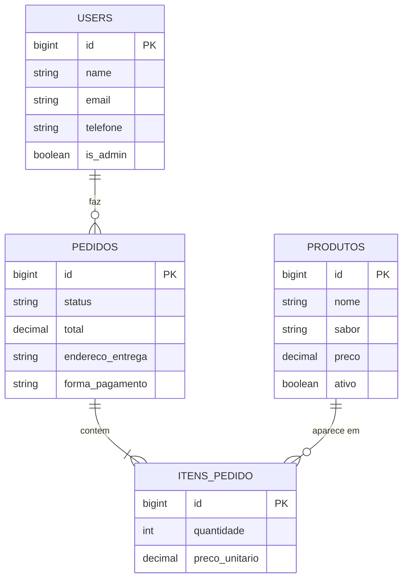

# 3. Modelo de dados

SGBD escolhido: **MySQL 8** (popular, de fácil manutenção, suportado pela hospedagem e pelo
Laravel). O acesso é feito pelo Eloquent, o ORM do Laravel, por meio de *migrations* versionadas.

## 3.1 Projeto conceitual



Entidades: **cliente/administrador** (`users`), **cupcake** (`produtos`), **pedido** (`pedidos`) e
**item do pedido** (`itens_pedido`). Um cliente faz vários pedidos, um pedido tem um ou mais itens e
cada item refere-se a um cupcake. A relação entre pedido e cupcake é muitos-para-muitos e foi
resolvida pela entidade associativa `itens_pedido`, que carrega a quantidade e o preço da compra.

## 3.2 Projeto lógico normalizado

Relações, com chave primária sublinhada pela notação `PK` e chaves estrangeiras `FK`:

- `users` (**id** PK, name, email, telefone, password, is_admin, remember_token, created_at, updated_at)
- `produtos` (**id** PK, nome, descricao, sabor, preco, ativo, created_at, updated_at)
- `pedidos` (**id** PK, user_id FK → users, status, taxa_entrega, total, endereco_entrega, forma_pagamento, observacao, created_at, updated_at)
- `itens_pedido` (**id** PK, pedido_id FK → pedidos, produto_id FK → produtos, quantidade, preco_unitario, created_at, updated_at)

**Verificação das formas normais**

- **1FN:** todos os atributos são atômicos (o endereço de entrega é um texto único do pedido, e
  não uma lista; os itens ficam em tabela própria, sem grupos repetidos).
- **2FN:** em `itens_pedido` a chave primária é simples (`id`), então não há dependência parcial.
  A restrição única (`pedido_id`, `produto_id`) impede o mesmo cupcake duas vezes no mesmo pedido
  (a quantidade cobre esse caso).
- **3FN:** nenhum atributo não chave depende de outro atributo não chave. Os dados do cupcake
  (nome, sabor) ficam só em `produtos`, e os dados do cliente só em `users`.

**Decisões de desnormalização controlada** (conscientes e documentadas):

- `itens_pedido.preco_unitario` repete o preço do cupcake no momento da compra (regra RN05).
  Sem isso, uma mudança de preço alteraria pedidos antigos.
- `pedidos.total` guarda o total calculado na finalização, pelo mesmo motivo histórico.
- `pedidos.endereco_entrega` guarda o endereço usado naquele pedido, pois o cliente pode mudar de
  endereço depois.

## 3.3 Projeto físico (MySQL)

O script abaixo é equivalente ao que as migrations do Laravel criam (`database/migrations`).

```sql
CREATE TABLE users (
    id              BIGINT UNSIGNED NOT NULL AUTO_INCREMENT,
    name            VARCHAR(120)    NOT NULL,
    email           VARCHAR(150)    NOT NULL,
    telefone        VARCHAR(20)     NULL,
    password        VARCHAR(255)    NOT NULL,
    is_admin        TINYINT(1)      NOT NULL DEFAULT 0,
    remember_token  VARCHAR(100)    NULL,
    created_at      TIMESTAMP       NULL,
    updated_at      TIMESTAMP       NULL,
    PRIMARY KEY (id),
    UNIQUE KEY users_email_unique (email)
) ENGINE=InnoDB DEFAULT CHARSET=utf8mb4 COLLATE=utf8mb4_unicode_ci;

CREATE TABLE produtos (
    id          BIGINT UNSIGNED NOT NULL AUTO_INCREMENT,
    nome        VARCHAR(100)    NOT NULL,
    descricao   TEXT            NOT NULL,
    sabor       VARCHAR(60)     NOT NULL,
    preco       DECIMAL(8,2)    NOT NULL,
    ativo       TINYINT(1)      NOT NULL DEFAULT 1,
    created_at  TIMESTAMP       NULL,
    updated_at  TIMESTAMP       NULL,
    PRIMARY KEY (id),
    KEY produtos_ativo_index (ativo)
) ENGINE=InnoDB DEFAULT CHARSET=utf8mb4 COLLATE=utf8mb4_unicode_ci;

CREATE TABLE pedidos (
    id                BIGINT UNSIGNED NOT NULL AUTO_INCREMENT,
    user_id           BIGINT UNSIGNED NOT NULL,
    status            VARCHAR(20)     NOT NULL DEFAULT 'recebido',
    taxa_entrega      DECIMAL(8,2)    NOT NULL,
    total             DECIMAL(10,2)   NOT NULL,
    endereco_entrega  VARCHAR(255)    NOT NULL,
    forma_pagamento   VARCHAR(20)     NOT NULL,
    observacao        VARCHAR(255)    NULL,
    created_at        TIMESTAMP       NULL,
    updated_at        TIMESTAMP       NULL,
    PRIMARY KEY (id),
    KEY pedidos_user_id_created_at_index (user_id, created_at),
    KEY pedidos_status_index (status),
    CONSTRAINT pedidos_user_id_foreign FOREIGN KEY (user_id) REFERENCES users (id)
) ENGINE=InnoDB DEFAULT CHARSET=utf8mb4 COLLATE=utf8mb4_unicode_ci;

CREATE TABLE itens_pedido (
    id              BIGINT UNSIGNED NOT NULL AUTO_INCREMENT,
    pedido_id       BIGINT UNSIGNED NOT NULL,
    produto_id      BIGINT UNSIGNED NOT NULL,
    quantidade      SMALLINT UNSIGNED NOT NULL,
    preco_unitario  DECIMAL(8,2)    NOT NULL,
    created_at      TIMESTAMP       NULL,
    updated_at      TIMESTAMP       NULL,
    PRIMARY KEY (id),
    UNIQUE KEY itens_pedido_pedido_produto_unique (pedido_id, produto_id),
    CONSTRAINT itens_pedido_pedido_id_foreign FOREIGN KEY (pedido_id) REFERENCES pedidos (id) ON DELETE CASCADE,
    CONSTRAINT itens_pedido_produto_id_foreign FOREIGN KEY (produto_id) REFERENCES produtos (id)
) ENGINE=InnoDB DEFAULT CHARSET=utf8mb4 COLLATE=utf8mb4_unicode_ci;
```

Pontos do projeto físico:

- **Dinheiro em `DECIMAL`**, nunca em ponto flutuante, para evitar erros de arredondamento.
- **Índices** em `produtos.ativo` (o cardápio filtra por ele), em `pedidos (user_id, created_at)`
  (lista dos pedidos do cliente, do mais recente ao mais antigo) e em `pedidos.status` (painel da
  loja).
- **Integridade referencial:** um cupcake ou cliente com pedidos não pode ser apagado (chave
  estrangeira sem cascata); os itens somem junto com o pedido (`ON DELETE CASCADE`). Cupcakes sem
  uso são desativados (`ativo = 0`), e não apagados.
- Codificação **utf8mb4** para aceitar acentos e emojis.

## 3.4 Dicionário de dados

### users

| Coluna | Tipo | Nulo | Padrão | Descrição |
|---|---|---|---|---|
| id | BIGINT UNSIGNED | não | auto incremento | Identificador do usuário (PK) |
| name | VARCHAR(120) | não | | Nome completo |
| email | VARCHAR(150) | não | | E-mail de acesso, único (RN01) |
| telefone | VARCHAR(20) | sim | | Telefone de contato com DDD |
| password | VARCHAR(255) | não | | Senha com hash (bcrypt) |
| is_admin | TINYINT(1) | não | 0 | 1 = administrador da loja, 0 = cliente |
| remember_token | VARCHAR(100) | sim | | Token do "manter conectado" |
| created_at, updated_at | TIMESTAMP | sim | | Datas de criação e atualização |

### produtos

| Coluna | Tipo | Nulo | Padrão | Descrição |
|---|---|---|---|---|
| id | BIGINT UNSIGNED | não | auto incremento | Identificador do cupcake (PK) |
| nome | VARCHAR(100) | não | | Nome exibido no cardápio |
| descricao | TEXT | não | | Descrição do cupcake |
| sabor | VARCHAR(60) | não | | Sabor principal (usado no filtro) |
| preco | DECIMAL(8,2) | não | | Preço unitário atual, em reais |
| ativo | TINYINT(1) | não | 1 | 1 = aparece no cardápio (RN09) |
| created_at, updated_at | TIMESTAMP | sim | | Datas de criação e atualização |

### pedidos

| Coluna | Tipo | Nulo | Padrão | Descrição |
|---|---|---|---|---|
| id | BIGINT UNSIGNED | não | auto incremento | Número do pedido (PK) |
| user_id | BIGINT UNSIGNED | não | | Cliente que fez o pedido (FK → users.id) |
| status | VARCHAR(20) | não | recebido | recebido, em_preparo, saiu_para_entrega, entregue ou cancelado (RN07) |
| taxa_entrega | DECIMAL(8,2) | não | | Taxa de entrega aplicada ao pedido (RN06) |
| total | DECIMAL(10,2) | não | | Total = soma dos itens + taxa (RN06) |
| endereco_entrega | VARCHAR(255) | não | | Endereço informado na finalização |
| forma_pagamento | VARCHAR(20) | não | | pix, dinheiro ou cartao (pago na entrega) |
| observacao | VARCHAR(255) | sim | | Observação do cliente (opcional) |
| created_at, updated_at | TIMESTAMP | sim | | Datas de criação e atualização |

### itens_pedido

| Coluna | Tipo | Nulo | Padrão | Descrição |
|---|---|---|---|---|
| id | BIGINT UNSIGNED | não | auto incremento | Identificador do item (PK) |
| pedido_id | BIGINT UNSIGNED | não | | Pedido a que pertence (FK → pedidos.id, cascata) |
| produto_id | BIGINT UNSIGNED | não | | Cupcake comprado (FK → produtos.id) |
| quantidade | SMALLINT UNSIGNED | não | | Quantidade, de 1 a 20 (RN04) |
| preco_unitario | DECIMAL(8,2) | não | | Preço do cupcake na data da compra (RN05) |
| created_at, updated_at | TIMESTAMP | sim | | Datas de criação e atualização |

As tabelas `password_reset_tokens`, `sessions`, `cache`, `jobs` e afins vêm do próprio Laravel e
não fazem parte do domínio do negócio.
