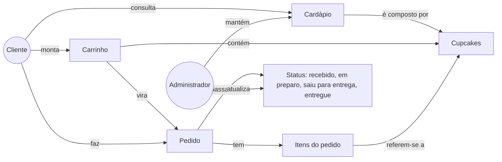
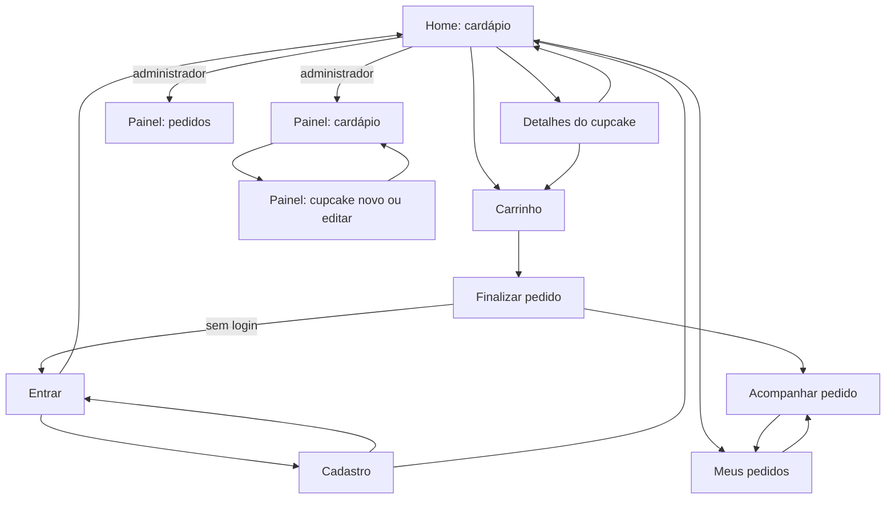

# 4. Interface e navegação (IHC)

Revisão do protótipo do PIT I: mapa conceitual, mapa navegacional, lista de telas, mensagens de
erro e verificação pelas heurísticas de Nielsen.

## 4.1 Mapa conceitual

## 4.2 Mapa navegacional

A **Home (cardápio)** é o centro da navegação, como definido no PIT I, e agora abre com um destaque visual, faixa de vantagens, cardápio por categoria e explicação do passo a passo. Todas as telas voltam a ela
pelo logotipo ou pelo menu.

## 4.3 Telas do sistema

| Tela | Rota | Acesso | Fluxo |
|---|---|---|---|
| Cardápio (Home) | `/` | todos | compra |
| Detalhes do cupcake | `/cupcakes/{id}` | todos | compra |
| Carrinho | `/carrinho` | todos | compra |
| Cadastro | `/cadastro` | visitante | autenticação |
| Entrar | `/entrar` | visitante | autenticação |
| Finalizar pedido | `/pedidos/novo` | cliente | compra |
| Meus pedidos | `/pedidos` | cliente | acompanhamento |
| Acompanhar pedido | `/pedidos/{id}` | dono do pedido e administrador | acompanhamento |
| Painel: pedidos | `/admin/pedidos` | administrador | gestão |
| Painel: cardápio | `/admin/cupcakes` | administrador | gestão |
| Painel: cupcake novo/editar | `/admin/cupcakes/novo`, `/admin/cupcakes/{id}/editar` | administrador | gestão |
| Avaliar o site | `/avaliar` e janela "Avaliar o site" em todas as telas | todos | teste |
| Painel: avaliações | `/admin/avaliacoes` | administrador | teste |
| Créditos das imagens | `/creditos` | todos | institucional |
| Telas de erro | 403, 404, 419, 429, 500, 503 | todos | erro |

## 4.4 Mensagens de erro e de sucesso

Todas as mensagens são em português, dizem o que aconteceu e como resolver, e aparecem no topo da
página (com `role="alert"` para leitores de tela) além de marcar o campo com problema.

| Situação | Mensagem |
|---|---|
| Campo obrigatório vazio | "O campo e-mail é obrigatório." |
| E-mail em formato inválido | "Informe um e-mail válido, como nome@exemplo.com." |
| E-mail já cadastrado | "Este e-mail já está em uso." |
| Senha curta | "O campo senha deve ter pelo menos 8 caracteres." |
| Confirmação de senha diferente | "A confirmação de senha não confere." |
| Telefone inválido | "Informe o telefone com DDD, por exemplo (83) 99999-0000." |
| Login incorreto | "E-mail ou senha incorretos." (não revela qual dos dois errou) |
| Quantidade fora do limite | "O campo quantidade deve estar entre 1 e 20." |
| Endereço incompleto | "Informe o endereço completo: rua, número e bairro." |
| Forma de pagamento não escolhida | "O campo forma de pagamento é obrigatório." |
| Finalizar com carrinho vazio | "Seu carrinho está vazio. Escolha ao menos um cupcake para finalizar o pedido." |
| Cancelar pedido fora de prazo | "Este pedido já saiu para entrega ou foi finalizado e não pode mais ser cancelado." |
| Página inexistente | Tela 404: "Página não encontrada", com botão "Voltar ao cardápio" |
| Sem permissão | Tela 403: "Acesso negado" |
| Sessão expirada | Tela 419: "Sessão expirada" |
| Muitas tentativas de login | Tela 429: "Muitas tentativas" |
| Avaliação sem nome | "O campo nome é obrigatório." |
| Captura de tela inválida | "A captura de tela deve ser JPG, PNG ou WebP." |
| Avaliação enviada | "Obrigado! Sua avaliação foi enviada." |
| Pedido feito | "Pedido #12 realizado com sucesso!" |
| Item no carrinho | "Brigadeiro Cremoso adicionado ao carrinho." |

## 4.5 Verificação pelas heurísticas de Nielsen

| Heurística | Como o sistema atende |
|---|---|
| Visibilidade do estado do sistema | Contador de itens no menu do carrinho; barra de progresso do frete grátis; linha do tempo e selo colorido de status no pedido; avisos após cada ação |
| Correspondência com o mundo real | Linguagem de loja ("cardápio", "carrinho", "saiu para entrega"), valores em reais |
| Controle e liberdade do usuário | Cliente pode alterar quantidades, remover itens e cancelar o pedido antes da entrega; links "Voltar" em todas as telas |
| Consistência e padrões | Mesmos componentes (botões, cartões, tabelas, selos) e mesmo menu em todas as telas |
| Prevenção de erros | Limites de quantidade, confirmação antes de remover item ou cancelar pedido, botão desativado após o clique para evitar envio duplo |
| Reconhecimento em vez de memorização | Resumo do pedido na tela de finalização; opções de pagamento em lista; campos com exemplos (placeholders) |
| Flexibilidade e eficiência | Filtro por categoria e busca por nome ou sabor; botão "Adicionar" direto no cartão do cardápio; botão "Avaliar o site" sempre à mão |
| Estética e design minimalista | Telas limpas, uma ação principal por tela, cores quentes com bom contraste |
| Ajuda para reconhecer e corrigir erros | Mensagens claras com orientação; campos com erro destacados em vermelho |
| Ajuda e documentação | Manual de uso em `docs/situacao-2-codigo/manual-de-uso.md` |

Identidade visual: paleta de tons de framboesa, rosa e chocolate; títulos em fonte serifada (Fraunces) e textos em DM Sans; fotos reais dos cupcakes (licença livre, créditos em `docs/creditos-das-imagens.md`).

Acessibilidade: rótulo (`label`) em todos os campos, atalho "Pular para o conteúdo", foco visível
no teclado, contraste de cores adequado e layout que se adapta a telas de celular (tabelas viram
blocos em telas pequenas).
