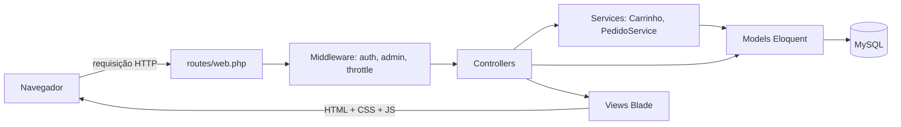

# Arquitetura

## Visão geral (MVC)

## Camadas e responsabilidades

| Camada | Arquivos | Responsabilidade |
|---|---|---|
| Rotas | `routes/web.php` | Mapeia URLs para controllers e define quem acessa (visitante, cliente, administrador) |
| Middleware | `app/Http/Middleware/ApenasAdmin.php`, `auth`, `guest`, `throttle` | Controle de acesso e limite de tentativas de login |
| Controllers | `app/Http/Controllers` | Validam os dados de entrada e escolhem a resposta; sem regra de negócio pesada |
| Serviços | `app/Services` | `Carrinho` guarda os itens na sessão; `PedidoService` cria pedido e itens em uma transação |
| Models | `app/Models` | Relações e regras do domínio (`Pedido::podeSerCancelado`, `avancarStatus`, `Produto::ativos`) |
| Políticas | `app/Policies/PedidoPolicy.php` | Um cliente só vê e cancela os próprios pedidos |
| Views | `resources/views` | Templates Blade; layout único em `layouts/app.blade.php` |
| Banco | `database/migrations`, `database/seeders` | Estrutura e dados iniciais, versionados |
| Configuração da loja | `config/loja.php` | Taxa de entrega, limites de quantidade e formas de pagamento |

## Tratamento de erros

- **Validação:** todo formulário valida no servidor; o usuário volta ao formulário com mensagens
  em português e os dados já digitados preservados.
- **Autorização:** acesso indevido gera `403`; recursos inexistentes ou desativados geram `404`.
- **Telas de erro** próprias para 403, 404, 419, 429, 500 e 503 (`resources/views/errors`).
- **Transação:** a criação do pedido e dos itens acontece em `DB::transaction`; se algo falhar,
  nada é gravado.
- **Regras de domínio** lançam `DomainException` (por exemplo, cancelar um pedido que já saiu para
  entrega) e os controllers as tratam antes de chegar ao usuário.

## Segurança

- Senhas com hash (bcrypt, pelo cast `hashed` do Laravel).
- Proteção CSRF em todos os formulários (`@csrf`).
- Escape automático de saída nas views Blade (`{{ }}`), contra XSS.
- Consultas pelo Eloquent com parâmetros preparados, contra injeção de SQL.
- Limite de 10 tentativas de login por minuto (`throttle:10,1`) e sessão regenerada ao entrar.
- Rotas de administração protegidas por middleware; dados de pedidos protegidos por política.
